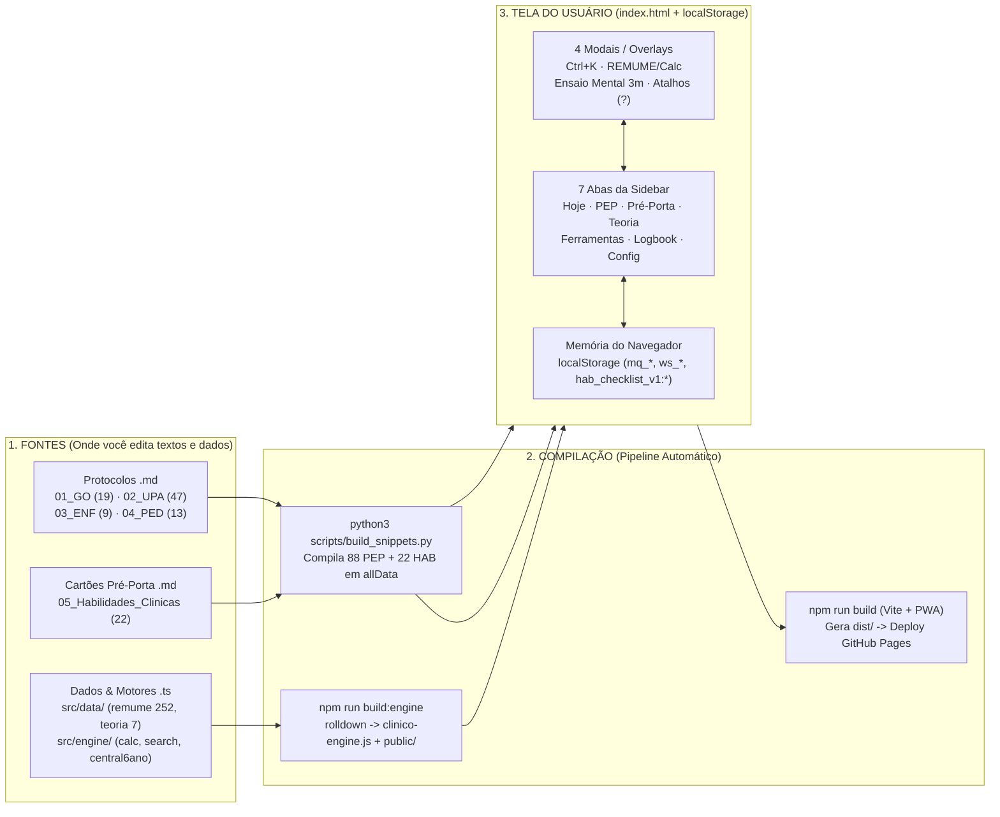

# 🗺️ Árvore & Mapa de Interações do Cockpit Clínico (Editável)

> **Como usar este documento para reestruturar o programa:**
> 1. Se preferir editar **visualmente clicando/movendo/conectando**, abra [mapa-arquitetura-editavel.html](file:///home/wagmoraes/Projetos%20IA/Protocolos_Clinicos/docs/mapa-arquitetura-editavel.html) no navegador, ajuste sua árvore e clique em **Copiar Plano (.md)**.
> 2. Se preferir editar **direto em texto**, edite as tags `[MANTER]`, `[MOVER -> ...]`, `[FUNDIR COM ...]`, `[REMOVER]`, `[NOVO]` abaixo e envie o arquivo de volta no chat.

---

## 1. Visão Macro: Como o Programa Nasce e Roda (3 Camadas)

---

## 2. Árvore Hierárquica Atual da Interface (Editável)

> **Legenda de edição rápida:** troque a tag entre colchetes por `[MANTER]`, `[MOVER -> Destino]`, `[FUNDIR COM X]`, `[REMOVER]` ou `[NOVO]`, e adicione `-> Nota:` logo abaixo se quiser mudar comportamento.

### A. Shell Global (Moldura Fixa + Atalhos + Modais)
- `[MANTER]` **Barra Lateral Esquerda (`#wsSidebar`)**
  - `[MANTER]` Logo & Toggle Tema (`☀️ / 🌙`) + Modo Zen (`Alt+Z`) + Recolher Sidebar (`Alt+B`)
  - `[MANTER]` Botão **Busca Global (`Ctrl+K`)** (`openCmdPalette()`)
  - `[MANTER]` Menu Principal das **7 Seções (`#wsMainSectionNav`)**
  - `[MANTER]` Filtro Especialidades (`#wsPepSubnavSection` — só aparece em `PEP` e `Pré-Porta`): Geral (`110`), GO (`19`), UPA (`47`), Enfermaria (`9`), Pediatria (`13`), Habilidades (`22`)
  - `[MANTER]` Atalhos fixos no rodapé da sidebar: **💊 REMUME (252)** e **🧮 Calculadoras** (`openRemumeCalcModal`) + Atalhos (`?`)
- `[MANTER]` **Barra Inferior Mobile (`#mobileBottomBar` — `< 768px`)**
  - `[MANTER]` Alternar `📅 6º Ano` ↔ `🩺 PEP` | `🔍 Ctrl+K` | `⬆️ Topo` | `💊 REMUME`
- `[MANTER]` **4 Modais Flutuantes Globais**
  - `[MANTER]` `#cmdOverlay` (**Ctrl+K Busca Semântica**): pesquisa os 88 PEP + 22 Pré-Porta + 252 REMUME + 7 Módulos Teoria + 4 Ferramentas + 12 linhas da Tabela LR+/LR-
  - `[MANTER]` `#remumeCalcOverlay` (**REMUME 252 & Calculadoras UBS/UPA**): Renal (`CKD-EPI 2021`, `Cockcroft-Gault`), `IG/DPP (DUM/USG)`, `IMC / Na+ / Ca++`, `CURB-65`, `Centor/McIsaac`, `Wells TVP`, `CHA₂DS₂-VASc`
  - `[MANTER]` `#ensaioMentalOverlay` (**Timer 3 min de Ensaio Mental Pré-Procedimento**)
  - `[MANTER]` `#shortcutsOverlay` (**Guia de Atalhos de Teclado `?`**)

---

### B. As 7 Abas do Programa (Onde você navega)

#### 1. `📅 Hoje (6º Ano)` — `#secPaneHoje`
*Painel diário dinâmico cruzando Rodízio × Marcha × Arquétipo do dia.*
- `[MANTER]` Controles superiores: `Rodízio Atual` + `Marcha (1..4)` + `Dia da Semana` + `Sincronizar Hoje Real`
- `[MANTER]` **Checklist Diário / Timeline** (`renderHojeSection()`, estado salvo por dia em `checkedTimelineByDay`)
- `[MANTER]` **Rastreador 70/30 de Questões MedQuest** (Âncora 70% vs. Trilha 30% + Streak diário sem duplicação + Anki hoje)
- `[MANTER]` **Cronômetro de Bloco de Estudo** (`start/pause/reset`)
- `[MANTER]` **Resumo de Pontos Cegos Recentes** (puxa direto do **Logbook**) & **Prompts de IA em 1 Clique** (`Paciente Simulado`, `Oratória`, `Raciocínio`, `Exames`, `OSCE`)
- `[MANTER]` **Checklist Curricular & Ritual de Domingo**

#### 2. `🩺 Protocolos PEP` — Lista Central + `#drawerPanel` (Cockpit Direito)
*88 protocolos para copiar no prontuário eletrônico ou preencher ao vivo.*
- `[MANTER]` **Coluna Central (`.ws-list-pane`)**: barra de busca por queixa/sintoma + chips de subcategoria + 88 cards com badge de gravidade (`CRÍTICO`, `URGENTE`, `ROTINA`) e cópia rápida (`Snippet`, `Conduta`, `Receita`)
- `[MANTER]` **Cockpit Direito (6 abas do protocolo PEP)**:
  1. `Snippet Completo` — texto pronto para colar no prontuário
  2. `Personalizar` — campos `[ ]` clicáveis inline, cálculo de DUM/IG/IMC, preenchimento automático de **doses pediátricas por peso**, `Alt+V` (SSVV normais), `Alt+D` (hoje/agora), `Alt+N` (próximo vazio), `Alt+E` (**Edição Livre** com Undo)
  3. `Conduta` — prescrição/manejo do pronto-socorro/enfermaria isolada
  4. `Receita` — prescrição ambulatorial/alta (`60` protocolos têm receita isolada)
  5. `🛒 Carrinho` (`#tabCartBtn`) — compositor modular que soma itens de várias receitas e persiste em `mq_prescription_cart_v1`
  6. `Diretrizes` — raciocínio clínico / "Por Quê" formatado
- `[MANTER]` **Power Actions (`1`–`5`)**: atalhos de teclado/botões no topo direito para copiar Tudo, Conduta, Receita, Evolução ou Orientações.

#### 3. `🧠 Pré-Porta 30s` — Lista (aba `hab`) + `#drawerPanel.drawer-hab`
*22 cartões de habilidades clínicas (Anamnese, Exame Físico, ECG, RX, Gaso, CTG, SPIKES, 7 Travas, ABCDE, Procedimentos, Sutura, IOT).*
- `[MANTER]` **Aba 1: Pré-Porta 30s** — âncora mental + roteiro sequencial + botão `📚 Ler Formação Teórica deste Pilar` (salta para a aba **Teoria**)
- `[MANTER]` **Aba 2: Checklist Pós-Atendimento** — checkboxes persistentes por cartão (`hab_checklist_v1:*`), painel ao vivo de itens esquecidos, `Copiar Debriefing` e `🎯 Salvar Pontos Cegos no Logbook` (envia direto para a aba **Logbook**)
- `[MANTER]` **Aba 3: Armadilhas & Erros Fatais** — lista de erros críticos do interno

#### 4. `📚 Formação Teórica` — `#secPaneTeoria`
*7 módulos completos de leitura em ~72ch (`src/data/formacao_teorica_data.ts`).*
- `[MANTER]` Navegação lateral dos 7 módulos com status (`Não iniciado` / `Estudado` / `Dominado`)
- `[MANTER]` Leitor com renderizador Markdown + Tabelas + LaTeX inline
- `[MANTER]` Barra de conexões no topo do artigo:
  - Cartões `🧠 Pré-Porta 30s` ligados ao módulo (clique abre direto o cartão)
  - 4 botões `Treinar Módulo com IA` (gera prompt focado no módulo aberto)

#### 5. `🧪 Ferramentas & Exames` — `#secPaneFerramentas`
*4 sub-abas clínicas de apoio rápido (além dos botões de acesso rápido para REMUME e Calculadoras).*
- `[MANTER]` Sub-aba 1: `🩸 Gasometria em 5 Passos` (Winter + AG corrigido pela albumina + Delta-Delta + 4 presets + copiar snippet p/ PEP)
- `[MANTER]` Sub-aba 2: `🎯 Tabela LR+/LR- & Simulador Bayesiano` (12 manobras clicáveis que preenchem LR+ ou LR- direto no simulador pré→pós-teste)
- `[MANTER]` Sub-aba 3: `🛡️ Checklist 7 Travas (A-R-G-I-V-P-O)` (conferência por paciente + reset)
- `[MANTER]` Sub-aba 4: `🚨 Guia das 6 Intercorrências de Madrugada` (checar em 2 min / 3 causas fatais / conduta segura)

#### 6. `📓 Logbook & Pontos Cegos` — `#secPaneLogbook`
*Registro de procedimentos do 6º ano, ensaio mental e diário de falhas.*
- `[MANTER]` **Ensaio Mental Cirúrgico (13 procedimentos)**: indicação, bandeja, marco anatômico, armadilha + modal **Timer 3 min**
- `[MANTER]` **Metas Motoras por Rodízio (12 metas)**: contadores `- / +1` com barra de progresso e filtro `"Só rodízio atual"` (lê o rodízio da aba **Hoje**)
- `[MANTER]` **Formulário em 60s + Histórico**: tipo (`Procedimento` / `Ponto Cego`), autonomia, vínculo opcional com cartão Pré-Porta, filtros por tipo/texto, botão excluir e exportação **Copiar `.md`** / **Baixar `.md`**

#### 7. `⚙️ Config & Backup` — `#secPaneConfig`
- `[MANTER]` Aparência (`Modo Claro` / `Modo Escuro`), Tela Inicial (`Hoje` ou `PEP`), Modo Zen, Sidebar Colapsada, Restaurar Colunas
- `[MANTER]` **Backup v2 Completo** (exportar texto, baixar `.json`, carregar arquivo `.json`, importar do campo) + Resumo Semanal `.md` + Limpar Dados Locais

---

## 3. Mapa de Interações ("Quando mexo em A, o que muda em B?")

| Origem (Onde você age) | Tipo de Ligação | Destino (O que reage / abre) | Função / Chave envolvida |
| :--- | :--- | :--- | :--- |
| **Hoje (6º Ano)** → Rodízio ativo | Alimenta contexto | **Logbook** (destaca/filtra metas do rodízio) & **Prompts IA** | `central6AnoState.rodizioId` |
| **Hoje** → Deep-links da timeline | Navega direto | **Teoria**, **Pré-Porta**, **Ferramentas**, **Logbook** ou **PEP** | `openTimelineShortcut()` |
| **Pré-Porta** → `📚 Ler Teoria` | Navega com vínculo | **Formação Teórica** no módulo correspondente | `openTeoriaFromHabCard()` |
| **Teoria** → Botões `🧠 Pré-Porta` | Navega com vínculo | **Pré-Porta 30s** abrindo o cartão exato | `openHabCardFromModule()` |
| **Pré-Porta** → `🎯 Salvar Pontos Cegos` | Grava registro | **Logbook** (entra como `ponto_cego`) → **Hoje** (preview) | `saveHabBlindspotsToLogbook()` |
| **PEP** → Botão `🛒 + Carrinho` | Adiciona itens | Aba **🛒 Carrinho** dentro do Cockpit | `addCurrentToPrescriptionCart()` (`mq_prescription_cart_v1`) |
| **PEP** → Peso em Pediatria | Calcula & preenche | Banner de doses + inputs da aba **Personalizar** | `applyWeightDosesToPrescription()` |
| **Ferramentas** → Botão `LR+` / `LR-` na tabela | Preenche input | **Simulador Bayesiano** calcula Probabilidade Pós-Teste | `runBayesCalcUI()` |
| **Ctrl+K** (`cmdOverlay`) | Busca unificada | Abre qualquer PEP, Pré-Porta, Teoria, Ferramenta ou copia REMUME | `updateCmdResults()` / `activateCmdItem()` |
| **Config** → **Backup v2 JSON** | Salva/Restaura tudo | Todas as chaves `mq_*`, `ws_col_widths_v1` e `hab_checklist_v1:*` | `buildCentral6BackupPayload()` / `importCentral6AnoBackupJson()` |

---

## 4. Meu Plano de Reestruturação (Espaço Livre para Você)

> Preencha abaixo se quiser reorganizar abas, simplificar telas ou criar novos fluxos — depois me peça para aplicar!

- **O que está confuso ou sobrando hoje:**
  - [ ] Ex.: ...
- **Como eu quero agrupar as abas:**
  - [ ] Ex.: ...
- **Novos fluxos / conexões que quero criar:**
  - [ ] Ex.: ...
